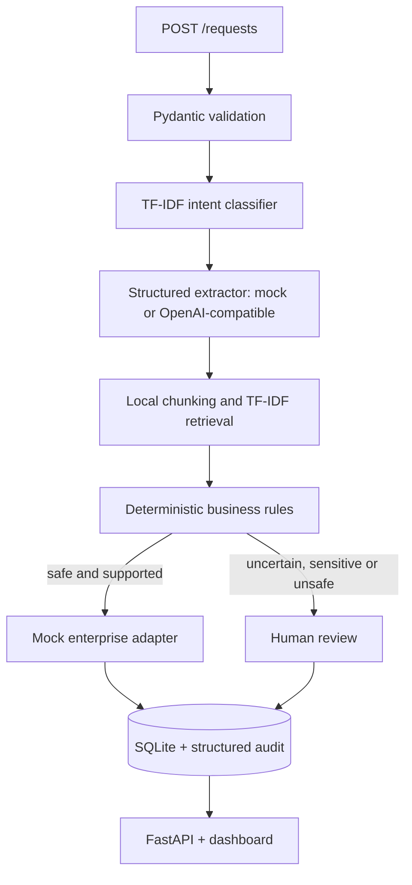

# Enterprise AI Automation Platform

## Business problem

Customer-operations teams receive repetitive refund, subscription, payment and order requests across channels. This portfolio prototype validates the request, classifies it, extracts structured fields, retrieves synthetic policy context, applies deterministic business rules and routes uncertain or sensitive cases to a human.

## Status of the implementation

- **Implemented:** FastAPI API, Pydantic validation, SQLite repository, structured audit events, deterministic workflow state transitions, local TF-IDF retrieval with source references, strict structured extraction, prompt-injection blocking, human approval/rejection, safe error handling, mock enterprise adapters and offline tests.
- **Simulated:** LLM provider in offline mode, enterprise actions (CRM/payment/email), company policy corpus and dashboard data.
- **Future work:** authentication/authorization, durable queueing, production secrets management, monitoring backend, real approved integrations, model calibration and a legally reviewed policy corpus.

No payment, CRM, email or customer system is contacted by this repository.

## Quick start

```bash
python3 -m venv .venv && source .venv/bin/activate
pip install -e .
pytest -q
uvicorn app.main:app --reload
```

Open `http://127.0.0.1:8000` for the dashboard and `/docs` for OpenAPI.

## Architecture



The modular monolith is intentionally small: `app/api`, `app/ai`, `app/workflows`, `app/database` and `app/schemas.py`. `app/orchestrator.py` coordinates the readable workflow without introducing microservices or infrastructure that the portfolio does not need.

## AI/ML evaluation

The reproducible experiment uses the official Banking77 `train.csv` and `test.csv` files, with TF-IDF word 1–2 grams and Logistic Regression (`random_state=42`, `max_iter=1000`). The vectorizer is fit on training data only. It writes measured outputs to `results/`:

```bash
python scripts/run_experiment.py
```

The latest execution in this workspace measured **10,003 training examples, 3,080 test examples, 77 classes, 0.857792 accuracy, 0.856805 macro F1 and 0.856805 weighted F1**, with 438 misclassified test examples. These are experiment results, not production performance claims. The run also creates `metrics.json`, `confusion_matrix.png`, `error_analysis.csv` and `model_comparison.csv`. The experiment may use the internet; unit tests do not download Banking77.

## RAG and LLM

Markdown documents in `data/documents/` are chunked and indexed using a lightweight local TF-IDF vector store. Retrieval returns top-k excerpts with source paths. If no relevant source is found, deterministic rules return `REQUIRES_HUMAN_REVIEW` rather than authorizing an unsupported action.

`app/ai/extractor.py` defines `LLMProvider`, an offline `MockLLMProvider` and an optional OpenAI-compatible provider. Configure `LLM_PROVIDER`, `LLM_MODEL`, `LLM_API_KEY`, `LLM_BASE_URL` and `LLM_TIMEOUT` using `.env` or the process environment. Provider output is strict JSON validated by Pydantic; invalid JSON, unexpected fields and timeouts fail safely without executing an action. Customer text is untrusted data and cannot change system rules, thresholds or review requirements.

## Workflow and API

The states are `RECEIVED`, `CLASSIFIED`, `PROCESSING`, `AUTO_APPROVED`, `REQUIRES_HUMAN_REVIEW`, `APPROVED_BY_HUMAN`, `REJECTED`, `COMPLETED` and `FAILED`. Transitions are centralized and invalid transitions are rejected. A refund can be auto-approved only when confidence, risk/urgency, policy evidence, order information, a readable amount and the amount limit all pass. Urgency and sensitive terms (hacked, fraud, chargeback, ...) are checked before any intent-specific rule; a refund whose amount cannot be read (or is 0) always goes to a human. The confidence used by the rules is the raw classifier probability, never adjusted by keyword rules. Cancellations and failures require human review.

Available endpoints: `POST /requests`, `GET /requests`, `GET /requests/{id}`, `GET /workflows/{id}`, `POST /workflows/{id}/approve`, `POST /workflows/{id}/reject`, `GET /audit/{workflow_id}` and `GET /health`.

Audit entries contain workflow ID, event type, component, status, optional duration and bounded metadata. Secrets and complete customer messages are not written into audit metadata.

## Testing and reproducibility

```bash
pip install -e .
pytest -q
python scripts/run_experiment.py
uvicorn app.main:app --reload
```

The test suite covers ML component behavior, safety regressions (amount parsing, unknown amounts, urgency precedence, raw confidence, dashboard HTML escaping), RAG, structured output validation, provider failure, API validation, workflow transitions, human review, database field validation, audit events and prompt-injection scenarios. Configuration defaults are documented in `.env.example`; Python and dependency versions are declared in `pyproject.toml`.

## Limitations

Authentication, authorization, encryption, high-availability storage, queue durability, production observability, multilingual model evaluation and legal/compliance approval are out of scope. The in-app intent classifier is a small demo model trained on a few dozen hand-written phrases; it is separate from the Banking77 experiment and has not been evaluated on real traffic. The confidence threshold is a configurable engineering decision, not a scientifically optimal calibration. Mock adapters must remain disconnected from real financial systems.
