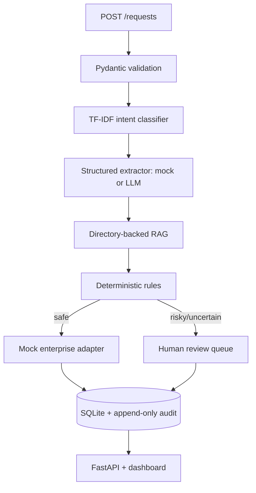

# Enterprise AI Automation Platform

## Business overview

This prototype helps a customer-operations team handle repetitive requests such as refunds, subscription cancellations, payment problems and order issues. It classifies the incoming message, extracts structured information, finds the relevant **demo company policy**, applies deterministic controls, executes only safe simulated actions, and sends sensitive or uncertain cases to a human reviewer.

The platform is not a chatbot and does not connect to payment, CRM, email or customer systems. Its value proposition is traceable workflow automation: faster triage, consistent policy lookup, reduced repetitive work and human oversight. No ROI or production outcome is claimed.

## Quick start

```bash
python3 -m venv .venv && source .venv/bin/activate
pip install -e .
uvicorn app.main:app --reload
pytest -q
```

Open `http://127.0.0.1:8000` for the operations dashboard and `/docs` for OpenAPI.

## Architecture



The modular code lives under `app/api`, `app/ai`, `app/workflows`, `app/database`, `app/schemas` and `app/services`-compatible boundaries. `app/orchestrator.py` remains the readable workflow coordinator.

## AI/ML

The application keeps a small offline fallback so tests remain deterministic. The real experiment is separate and uses the official public Banking77 train/test CSV files. It uses TF-IDF word 1–2 grams and Logistic Regression with a fixed random seed. It does not train on test labels.

```bash
python scripts/run_experiment.py
```

This creates measured `results/metrics.json`, `results/confusion_matrix.png`, `results/error_analysis.csv` and `results/model_comparison.csv`. The experiment may use the internet; `pytest -q` never downloads Banking77.

## LLM integration

`app/ai/extractor.py` defines an `LLMProvider` interface with an offline mock and an optional OpenAI-compatible provider. Configure `LLM_PROVIDER`, `LLM_MODEL`, `LLM_API_KEY`, `LLM_BASE_URL` and `LLM_TIMEOUT` through `.env` or the process environment. Responses are parsed as JSON and validated with strict Pydantic fields. Invalid JSON, missing fields, unexpected fields, timeout and provider errors stop automation and route the workflow to human review.

## RAG

Demo company documents are stored in `data/documents/` and explicitly labelled as synthetic demo documents. The pipeline loads Markdown files, chunks them, builds a TF-IDF vector index, returns top-k relevant chunks and exposes source references. No source means no automatic policy-driven action.

## Workflow, review and API

Configured auto-approval requires known intent, confidence above the configurable engineering threshold, required order information for refunds, relevant policy evidence, a policy-compatible action and no sensitive condition. Cancellation is always human-controlled. Actions use replaceable `EnterpriseAdapter` interfaces with safe mock implementations.

Available endpoints include `POST /requests`, `GET /requests`, `GET /requests/{id}`, `GET /workflows/{id}`, `POST /workflows/{id}/approve`, `POST /workflows/{id}/reject`, `GET /audit/{workflow_id}` and `GET /health`.

## Testing and reproducibility

Tests cover API validation, successful automation, human review, rejection, over-limit refunds and audit events. Test dependencies are mocked/offline. Python and dependency versions are pinned in `pyproject.toml`; model parameters, dataset source and random seed are recorded by the experiment output.

## Security and limitations

Secrets are environment-based and `.env` is ignored. Database files and raw data are ignored, logs do not include API keys, and simulated adapters never perform real financial actions. Authentication, authorization, encryption, queue durability, production observability and legal/compliance approval are intentionally out of scope. The `0.70` confidence threshold is a configurable business/engineering decision, not a scientifically optimal value.

See [`docs/current_architecture.md`](docs/current_architecture.md), [`docs/architecture.md`](docs/architecture.md) and [`docs/business_case.md`](docs/business_case.md).
