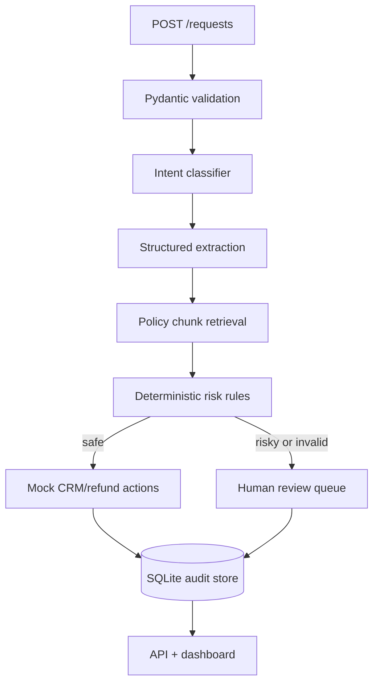

# Architecture

The orchestration layer persists every stage and emits an audit event with timestamp, actor, stage, confidence and error details. The normal application has no update/delete endpoint for audit events.

## Decision boundary

The model proposes intent and fields. Rules decide execution. A refund is auto-approved only if the request is valid, confidence is above threshold, policy allows it, the amount is within the configured limit, and the order is eligible. Subscription cancellation is treated as a sensitive action and goes to a human by default.
